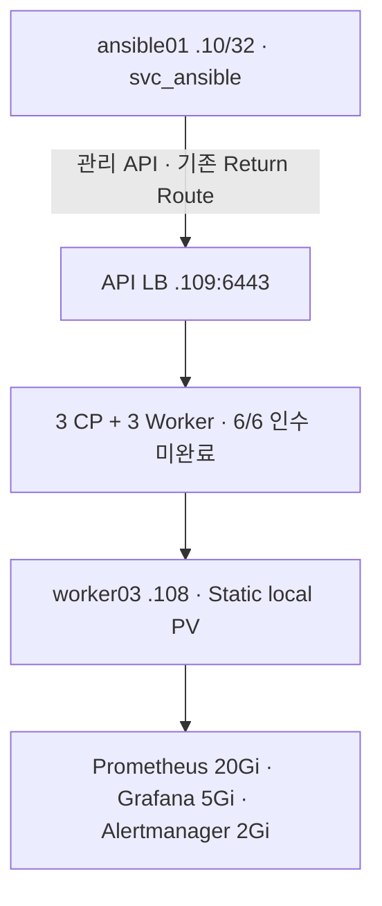
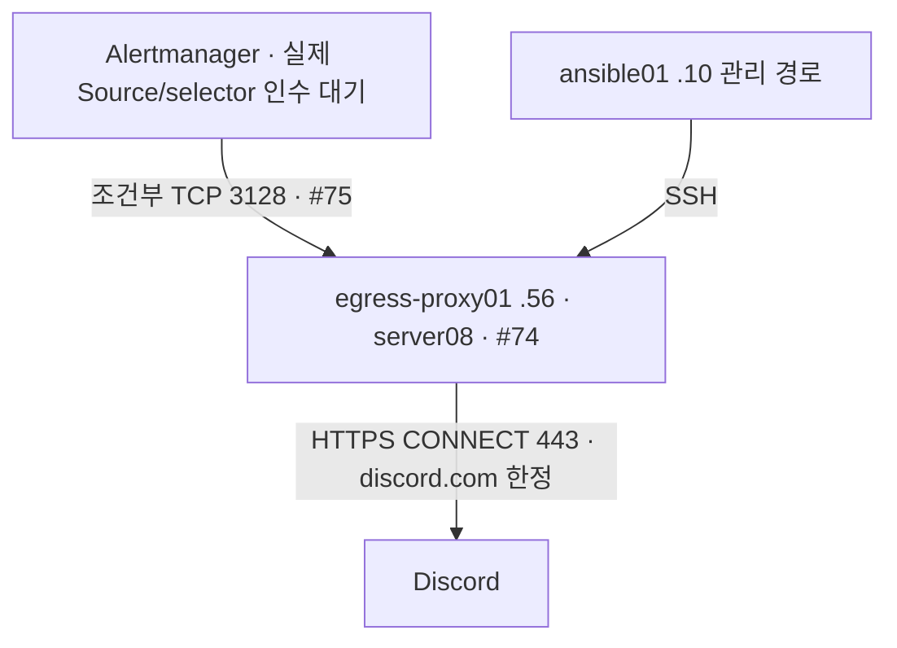

# v3.1.19 승인 변경 뷰

설계 입력의 범위를 나타내며 Runtime 인수도·전체 네트워크 대체도가 아니다. 기존 논리/물리 구조는 Baseline §4~13을 따른다.

- `.56` 배치는 DEC-P1-EGRESS-01(#78) 결정 완료; `.57/.59` Reserved 유지. server08 2vCPU/2GiB/30GiB, NIC ens160. 일반 Pod 인터넷 egress 허용이 아니다.
- #74 Squid 서비스·endpoint·실제 client Source, #75 NetworkPolicy/selector/Secret 주입·회전·폐기·허용/거부/복구는 인수 전이다.
- 관리 Source/identity 결정은 OID-01이며 내부 SNAT 금지. HEP/GNP는 6/6 Ready 이후 별도 실행창.
- Static local PV: worker03 `/home/fds-local-pv/{prometheus,grafana,alertmanager}`, no-provisioner/WFFC/Retain/nodeAffinity. non-HA이며 Runtime 검증 전.
- control01 내부 chronyd/UDP123 결정은 있으나 upstream/time authority 미정으로 INPUT_INCOMPLETE/RUNTIME_HOLD다. 임의 외부 NTP 목적지를 그리지 않는다.

근거: [#78](https://github.com/321Team/fds-project-baseline/issues/78), [#74](https://github.com/321Team/fds-project-baseline/issues/74), [#75](https://github.com/321Team/fds-project-baseline/issues/75), [Lead 결정](https://github.com/321Team/fds-project-baseline/issues/10#issuecomment-5697547621). `Approved_Change_View.svg`는 이 문서의 egress 관계를 배포용으로 표현한 파생본이다.
